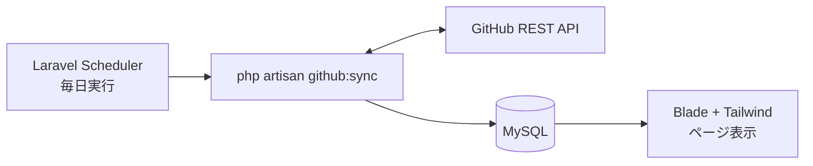

# Portfolio App

**公開URL: https://portfolio-kentaro-nakayama-production-zyo6xx.laravel.cloud**

GitHubで公開している自分のプロジェクトを紹介するポートフォリオサイトです。
GitHub REST APIから取得したリポジトリ情報をMySQLにキャッシュし、Laravel Schedulerで毎日自動更新しています。

リポジトリを増やしたりREADMEを書き換えたりすれば、サイト側は何もせずに追従します。
掲載内容のメンテナンスを「GitHubを普通に使うこと」に一本化するのが、この構成の目的です。

## 主な機能

| ページ | 内容 |
|---|---|
| ホーム `/` | 自己紹介と、直近に更新した3プロジェクトのダイジェスト |
| プロジェクト一覧 `/projects` | 同期済みリポジトリをカード表示。使用言語・GitHub topicsで絞り込み可能 |
| プロジェクト詳細 `/projects/{slug}` | READMEのMarkdownレンダリング、言語・star/fork数・topics、GitHubへのリンク |
| About `/about` | 経歴・スキル・今後の展望 |

### 設計上のポイント

- **表示は常にDBから**: 画面表示でGitHub APIを叩かないため、APIのレート制限や障害の影響を受けず、表示も高速
- **掲載対象の自動的な絞り込み**: fork・private・internalリポジトリ、プロフィールREADMEリポジトリ(アカウント名と同名のもの)、および設定で指定したリポジトリを除外
- **非公開化への追従**: public→privateへの変更やリポジトリ削除を検知し、同期時にDBから物理削除。公開をやめたリポジトリがサイトに残り続けない
- **READMEの相対パス解決**: README内の相対パスはGitHub上の絶対URLへ書き換え。画像は`raw.githubusercontent.com`、ドキュメントへのリンクはGitHubのレンダリング済みページ(`blob`)を指すよう用途で出し分け
- **スクリーンショットの自動抽出**: README内の先頭画像をサムネイルとして採用。shields.io等のバッジ画像やSVGは除外

## 技術スタック

| 項目 | 選定 |
|---|---|
| バックエンド | Laravel 13 / PHP 8.4 |
| フロントエンド | Blade + Tailwind CSS 4 (Vite) |
| データベース | MySQL 8 |
| 外部API | GitHub REST API |
| Markdown | league/commonmark |
| テスト | Pest 4 |
| 静的解析・整形 | Laravel Pint |
| CI | GitHub Actions (push/PR時にPint + Pestを自動実行) |
| ホスティング | Laravel Cloud (東京リージョン) |

## 構成



主要なクラス:

```
app/
├── Console/Commands/
│   ├── SyncGithubRepositories.php   # github:sync — API取得・保存・不要レコード削除
│   └── SyncTodoChecklist.php        # todo:sync  — テスト結果からTODO.mdを更新
├── Http/Controllers/
│   ├── HomeController.php
│   └── ProjectController.php        # 一覧(言語・topic絞り込み)と詳細
├── Models/Repository.php
└── Services/GitHub/
    ├── GitHubClient.php             # API呼び出しと掲載対象の判定
    ├── ReadmeRenderer.php           # Markdown → HTML、相対URLの書き換え
    ├── ReadmeScreenshotExtractor.php# README先頭画像の抽出(バッジ除外)
    └── GithubRawUrlResolver.php     # 相対パス → GitHubの絶対URL
```

## セットアップ

```sh
git clone https://github.com/kentaro-nakayama/PortfolioApp.git
cd PortfolioApp

composer install
npm install

cp .env.example .env
php artisan key:generate
```

`.env` に以下を設定します。

| 変数 | 内容 |
|---|---|
| `DB_*` | ローカルMySQLの接続情報(`portfolio`データベースを作成しておく) |
| `GITHUB_USERNAME` | リポジトリを取得するGitHubアカウント名 |
| `GITHUB_TOKEN` | (任意) Personal Access Token。未設定でも動作するがAPIレート制限が60回/時になる。publicリポジトリしか読まないため、Fine-grained tokenの「Public Repositories (read-only)」で足りる |
| `GITHUB_EXCLUDED_REPOSITORIES` | (任意) 一覧に載せたくないリポジトリ名をカンマ区切りで指定 |

```sh
php artisan migrate
php artisan github:sync   # GitHubからリポジトリ情報を取得してDBへ保存
composer dev              # 開発サーバーとViteを同時起動
```

依存インストールからビルドまでは `composer setup` でまとめて実行することもできます。

## コマンド

```sh
php artisan github:sync   # GitHubと同期(本番ではSchedulerが毎日実行)
php artisan schedule:list # スケジュール登録内容の確認
composer todo             # テストを実行し、対応するテストが通ったTODO項目に自動でチェックを入れる
```

## テスト

```sh
./vendor/bin/pest         # ユニット・機能テスト(45件 / 2026年10月時点)
./vendor/bin/pint --test  # コードスタイル検査
```

GitHub API連携部分は実際のAPIを叩かず、LaravelのHTTPクライアントをモックして検証しています。
`Http::preventStrayRequests()` により、モックし忘れたリクエストはテスト失敗として検出されます。

## デプロイ

Laravel Cloudにホスティングし、`main`へのpushで自動デプロイされます。

| 設定 | 内容 |
|---|---|
| Build commands | `composer install --no-dev` → `npm ci` → `npm run build` → `php artisan optimize` |
| Deploy commands | `php artisan migrate --force` |
| Scheduler | 有効(毎分`schedule:run`を実行し、`github:sync`を毎日実行) |
| Scale to Zero | 有効。アクセスが無い間はスリープし、スケジュール実行時は自動で起床 |

ヘルスチェックは `/up` で確認できます。

## ドキュメント

- [docs/requirements.md](./docs/requirements.md): テーブル定義、ページごとの仕様、同期処理の詳細、環境変数
- [TODO.md](./TODO.md): 実装チェックリスト(`composer todo`でテスト結果と同期)
- [CLAUDE.md](./CLAUDE.md): 要件定義と開発ルール
